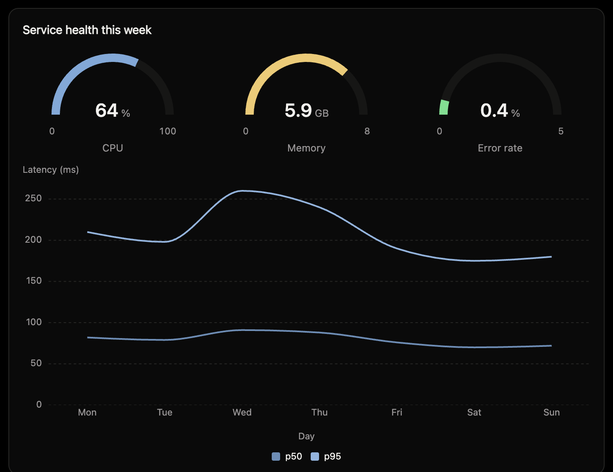
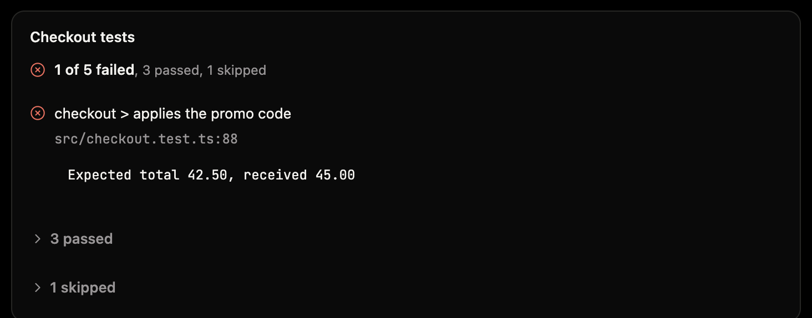
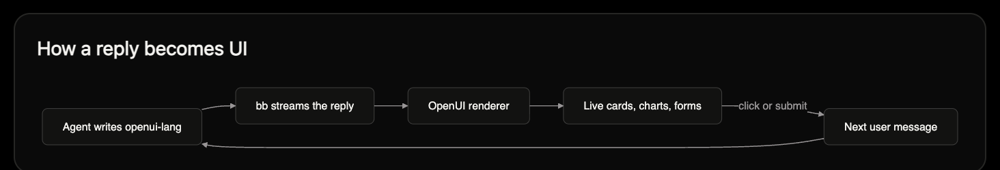
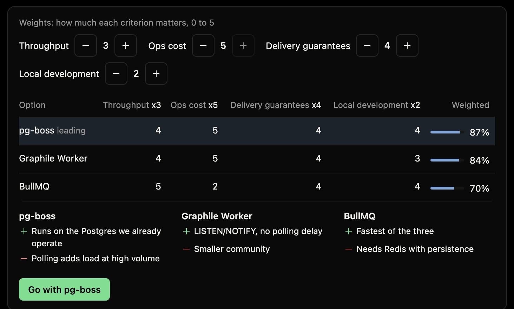

# OpenUI Live Replies

A [bb](https://getbb.app) plugin that lets agents answer with live UI: [OpenUI Lang](https://www.openui.com) blocks drawn inline in chat as cards, charts, tables, forms and more. Buttons and forms send the user's answer back into the thread.

See [PLUGIN_OVERVIEW.md](PLUGIN_OVERVIEW.md) for what it does, its requirements, and its costs.

<!-- VIDEO: open this file in GitHub's web editor and drag your .mp4 onto the line below.
     GitHub uploads it and replaces it with a https://github.com/user-attachments/assets/... link,
     which renders as an inline player. Delete this comment afterwards. -->
<!-- video goes here -->

## Screenshots

Everything below is a real reply in bb, rendered by this plugin.

**Dashboards**: gauges and charts from numbers the agent already has.



**Reports**: test runs with failures first, file and line.



**Diagrams**: flows drawn from Mermaid.



**Decisions you can click**: re-weight criteria live, then send the pick back to the agent.



<!-- More screenshots: save a PNG under docs/screenshots/ and add a line like
 -->

## Components

On top of OpenUI's standard library (cards, tables, charts, forms, tabs and more), this plugin adds the components below. Agents fetch their signatures with the `openui_components` tool when they need them, so the always-on prompt stays small. Plan, Decision, Choice, Quiz and FollowUps send the user's answer back into the thread as their next message.

### Numbers and charts

| Component | What it does |
| --- | --- |
| Progress | A level toward a goal: slim bar plus the figure. |
| Gauge | A level against a limit as a half-circle meter with the figure, e.g. CPU against 100%. |
| Sparkline | Tiny inline trend of a list of numbers, no axes, last value marked and printed. |
| SegmentedBar | Shares of one whole as one stacked bar with a legend of label, value and share. |
| CalendarHeatmap | Activity per day as weeks of squares, last 53 weeks at most. |
| Treemap | Sizes as nested rectangles, e.g. disk usage by folder. |
| Histogram | Distribution of raw values (latencies, sizes, scores) as counts per bin. |
| BoxPlot | Spread of several samples side by side: median, quartiles, whiskers at 1.5 IQR and outliers. |
| Heatmap | A matrix of numbers as shaded cells, e.g. errors by hour and day. |
| Funnel | Stages of a flow as shrinking bars with the conversion from the step before. |
| KeyValue | Facts as a list of name and value, e.g. branch, author, checks. |
| Diagram | Flowcharts, sequences and state machines from Mermaid source, drawn by bb's renderer. |
| Grid | Equal tiles side by side for comparable items (Gauges, small charts, short cards). |

### Inputs and learning

| Component | What it does |
| --- | --- |
| Stepper | A count with minus and plus buttons and a typed field (guests, servings, seats). |
| Rating | 1 to max stars (default 5) picked by click or arrow keys. |
| ListEditor | An editable list of short strings: add, edit, reorder and remove (labels, steps, names). |
| Swatches | CSS colours, plain or {value, name}. |
| FollowUps | Suggested next questions as a quiet list; a click sends that prompt as the user's next message. |
| Timer | A countdown from seconds with start, pause and reset; a stopwatch when seconds is omitted. |
| Quiz | A self-check quiz, one question at a time, with the score at the end and a button to send it. |
| Flashcards | A deck to practise: flip each card, mark it known or again, move back and forth; keeps a tally. |
| Walkthrough | A guide shown one step at a time with progress and previous/next; for procedures the user follows along. |

### Time and planning

| Component | What it does |
| --- | --- |
| Timeline | Dated events in order down a rail: incidents, histories, changelogs. |
| Calendar | Month grid of events with previous/next month; an agenda list on narrow widths. |
| Roadmap | Gantt of dated work by lane over a date axis, with a today line. |
| Board | Kanban board: one column per status with counts. |
| Status | Workstream health rows: worded status, progress, owner, due and a note. |
| Plan | A plan the user approves before work starts: numbered steps with files, risk and estimate, then Approve or Change something. |
| Decision | Weighted comparison the user tunes: weights (0-5, default 3) per criterion re-rank options live; Go with X sends the pick. |
| Choice | Options the user picks from, one large slide each in a carousel (arrows, dots, swipe): directions, designs, approaches. |
| Estimate | Three-point estimates: a range bar and PERT mean per task, total P50 and P90. |
| Acceptance | Is it really done: criteria with worded status and evidence, summary counts. |

### Structure and media

| Component | What it does |
| --- | --- |
| Tree | File or concept tree: path strings ("src/a.ts"; shared folders merge) or {label, children?, note?} nodes; folders fold. |
| Json | Collapsible JSON explorer for an inline value (object, array, or a string holding JSON); the user can copy any path or value. |
| Diff | One file's unified diff (a patch with ---/+++ and @@ hunks); language names the file type when the patch has no file headers. |
| Compare | Before and after, or reference against candidates: images side by side, as a wipe or a blink; the first image is the reference. |
| Hotspots | Numbered pins on an image (https URL or thread file path); selecting a pin shows its text. |
| Sources | Numbered list of cited web pages, matching [1], [2] in the text; opens them in BB's browser. |
| Entity | A product, place, person or organisation at a glance: facts is an object of label to value; image is an https URL or thread file path. |

### Workspace files

| Component | What it does |
| --- | --- |
| Snippet | Lines from..to (1-based, inclusive; omit for the whole file) of a file, numbered and highlighted, with a link that opens it at those lines. |
| File | A compact link to one workspace or thread-storage file that opens it in BB, optionally at a line. |
| FileImage | An image file (png, jpg, gif, webp, svg, avif) from the workspace or thread storage, at its natural aspect ratio. |
| Logs | Build or server output: source is a log file path or the text itself (ANSI and JSONL fine); errors and warnings counted and jumpable. |
| StackTrace | An error and its stack (JS/TS, Python, Java/Kotlin, Go, Rust, Ruby): trace is the printed text or a file path. |
| Transcript | Transcripts compared word by word: the first track is the reference; each other track gets its word error rate and its substitutions, deletions and insertions marked. |

### Reports

| Component | What it does |
| --- | --- |
| Tests | Test results, failures first with message and file:line. |
| Findings | Lint, type-check or review findings grouped by file. |
| Coverage | Code coverage totals and files worst first. |
| Dependencies | Outdated packages by major/minor/patch gap and vulnerabilities by severity. |
| Pipeline | A CI run: jobs and steps with status and durations, failures open. |
| Benchmark | Before/after measurements with the change in words, judged by `better` (default lower). |
| Waterfall | Timings as bars on a shared time axis: spans inline (start and duration in `unit`, default ms; depth indents) or a HAR file from the thread. |
| Provenance | What reached live, stage by stage from source, with facts (branch, sha, build, device...). |

### bb project

| Component | What it does |
| --- | --- |
| Changes | Files changed in this thread's environment with +/- counts, each opening its diff. |
| Commits | This branch's commits since its base branch, newest first; each opens the files it changed. |
| PullRequest | This thread's branch's GitHub pull request, live: title and link, state, checks, review and merge state. |
| Threads | Live status of BB threads: title, status, opens the thread. |
| Environments | This project's environments (checkouts and worktrees): branch, its live threads, uncommitted and ahead counts, pull request. |

### Maps, media and sandbox

| Component | What it does |
| --- | --- |
| Map | OpenStreetMap map with numbered pins and a list of the places. |
| ImageSearch | A freely licensed, credited photo from Wikimedia Commons for a short description. |
| App | A small self-contained HTML, CSS and JS page run in a sandboxed frame with no network. |
| Shader | A Shadertoy-style GLSL fragment shader: define void mainImage(out vec4 fragColor, in vec2 fragCoord); iTime, iResolution and iMouse are provided. |

## Install

Add this repo as a marketplace, then install from it:

```sh
bb marketplace add git:github.com/ahsan7162/bb-plugin-openui@main
bb plugin install openui@ahsan7162
```

Or install it directly:

```sh
bb plugin install git:github.com/ahsan7162/bb-plugin-openui@main
```

## Develop

```sh
npm install
bb plugin install .   # register this checkout
bb plugin dev         # rebuild and reload on save
npm test
```
